# Çarşı — el yapımı ürünler için e-ticaret, ödeme ve yönetim paneli


**Seramik, çini, kilim, ev tekstili ve bakır ürünler satan örnek bir butik mağaza: katalog, sepet ve kupon, kargo kuralı, KDV dahil fiyatlandırma, iyzico ödeme entegrasyonu (anahtar yoksa gerçekçi demo ödeme), kurallı sipariş durum makinesi ve rol bazlı yönetim paneli. Mağaza ve panel tek bir Next.js (App Router) uygulamasında.**

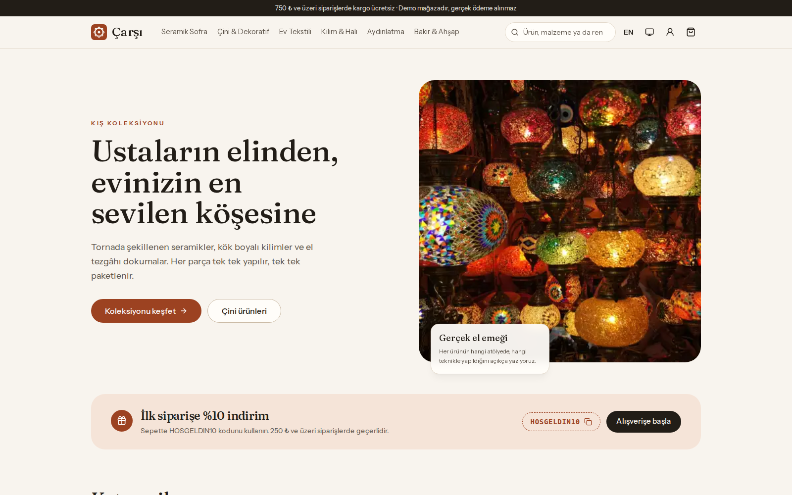

> Bu bir portföy projesidir. Gerçek ödeme alınmaz; varsayılan ödeme sağlayıcısı test kartlarıyla çalışan demo sağlayıcıdır.

## Demo hesaplar

Giriş ekranında (`/giris`) üç hesap için **tek tıkla demo girişi** düğmeleri vardır. Parola hepsi için `Demo123!`.

| Rol | E-posta | Görebilecekleri |
|---|---|---|
| Müşteri | `musteri@carsi.demo` | Sepet, ödeme, siparişlerim (kargoda/hazırlanıyor/teslim edilmiş siparişler hazır), adresler, yorum yazma |
| Yönetici (ADMIN) | `admin@carsi.demo` | Panelin tamamı: iade, kuponlar, denetim kaydı dahil |
| Personel (STAFF) | `personel@carsi.demo` | Panel; sipariş hazırlama/kargolama, ürün ve kategori yönetimi. İade, kupon ve denetim kaydı yok |

**Demo test kartları** (ödeme ekranında listelenir, “Bu kartı kullan” ile doldurulur; başka hiçbir kart numarası kabul edilmez):

| Kart | Sonuç |
|---|---|
| `5528 7900 0000 0008` (Mastercard) | Başarılı |
| `4766 6200 0000 0001` (Visa) | Başarılı |
| `4111 1111 1111 1129` | Başarısız: yetersiz bakiye |
| `4129 1111 1111 1111` | Başarısız: banka onaylamadı |
| `4124 1111 1111 1116` | Başarısız: CVC hatalı |

Kuponlar: `HOSGELDIN10` (%10, en az 250 ₺, en fazla 500 ₺ indirim), `CARSI150` (1.500 ₺ üzerine 150 ₺), `YAZ25` (süresi dolmuş; hata mesajını görmek için).

## Özellikler

**Mağaza**
- Ana sayfa: kampanya alanı (kopyalanabilir kupon kodu), kategoriler, öne çıkanlar, yeni gelenler.
- Ürün listesi: kategori, fiyat aralığı, “yalnızca stoktakiler” filtresi, 6 sıralama, arama ve sayfalama. Tüm durum URL'dedir (`/urunler?kategori=kilim&min=500&stok=1&sirala=fiyat-artan&sayfa=2`); geçersiz parametreler hata vermez, varsayılana döner. JavaScript olmadan da GET formu olarak çalışır.
- Ürün detayı: galeri, renk (renk örnekli) ve boyut varyantları, varyanta göre fiyat ve stok durumu (“Stokta son 3 adet”), puan dağılımı ve yorumlar. **Yalnızca ürünü satın alıp teslim almış müşteriler yorum yazabilir.**
- Sepet: misafir için çerezde tutulan sepet, girişte hesaptaki sepetle birleşir (adetler toplanır, stokla sınırlanır). Kupon: yüzde/tutar, geçerlilik tarihleri, alt limit, kullanım limiti ve en fazla indirim; reddedilirse nedeni (“1.000 ₺ eksik”) gösterilir.
- Ödeme akışı: adım göstergesi, kayıtlı adres seçimi ya da yeni adres (hesaba kaydetme seçeneğiyle), kargo kuralı (**indirimden sonra 750 ₺ ve üzeri ücretsiz**, altında 79,90 ₺), özet, ödeme.
- Hesabım: siparişler, sipariş detayı ve **durum zaman çizelgesi**, kargo takip numarası, PDF fatura, (kurala uyuyorsa) sipariş iptali, adres defteri.
- E-posta: sipariş onayı ve durum değişikliği (TR/EN şablonlar). `RESEND_API_KEY` varsa Resend ile gönderilir; yoksa yalnızca loglanır (konsol + `EmailLog` tablosu), akış durmaz.
- Fiyatlar TRY ve her dilde `tr-TR` biçiminde (`₺1.234,50`), KDV dahil; sepette ve faturada KDV tutarı ayrıca gösterilir.
- SEO: sayfa bazlı metadata ve OpenGraph, `sitemap.xml`, `robots.txt`, ürünlerde `Product` JSON-LD (fiyat aralığı, stok, puan ve yorumlar).

**Yönetim paneli** (`/admin`, ADMIN ve STAFF)
- Genel bakış: 30 günlük ciro, sipariş sayısı ve ortalama sepet (önceki 30 güne göre değişimle), bugünkü ciro, 60 günlük günlük ciro grafiği (Recharts, yalnızca panelde ve gerektiğinde yüklenir; tablo görünümü var), durumlara göre siparişler, en çok satanlar, düşük stok uyarıları, “hazırlanmayı bekleyen sipariş” bildirimi.
- Siparişler: durum, ödeme türü, tarih aralığı ve arama filtreleri (URL'de), TanStack Table, sayfalama; detayda kurallı durum güncelleme (kargoda için firma + takip no zorunlu), iptal/iade uyarısı, durum geçmişi, ödeme denemeleri, **PDF fatura indirme**.
- Ürünler: TanStack Table (arama, sıralama), ürün ekleme/düzenleme: TR/EN ad ve açıklamalar, fiyat/eski fiyat/KDV oranı, varyantlar (SKU, renk, boyut, fiyat farkı, stok), görseller (URL ya da repodaki görsel kütüphanesinden seçim). Görseli olmayan ürüne otomatik kapak üretilir.
- Müşteriler (sipariş sayısı, toplam harcama), kuponlar, kategoriler.
- **Denetim kaydı:** panelden yapılan her değişiklik (kim, ne, ne zaman, önce/sonra farkı).

**Genel**
- Türkçe (varsayılan) / İngilizce arayüz; tüm metinler sözlükten gelir, ürün ve kategori adları/açıklamaları iki dillidir.
- Sistem tercihini izleyen, elle değiştirilebilen açık/koyu tema (sunucu tarafında çerezle işlenir, açılışta yanıp sönme yok).
- Mobil uyum (390 px'te yatay kaydırma yok), klavye ile kullanım, görünür odak halkaları, erişilebilir adlar; emoji ikon yok (lucide-react).

## Ekran görüntüleri

| Ürün detayı | Ödeme (demo kart) |
|---|---|
| 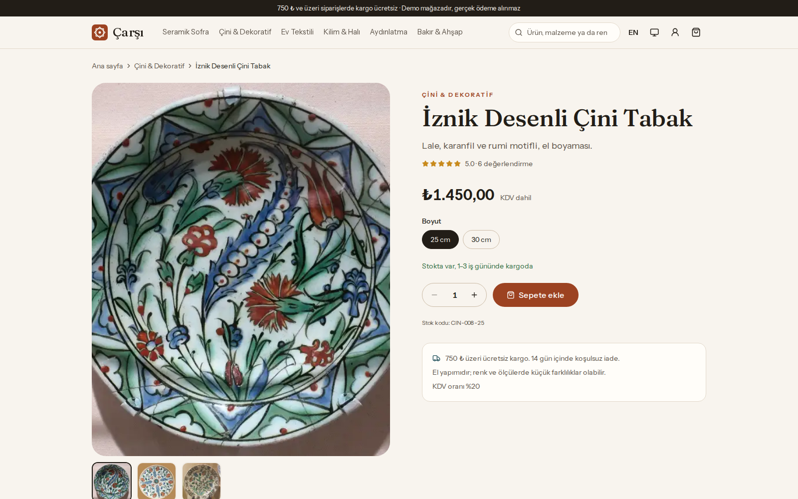 | 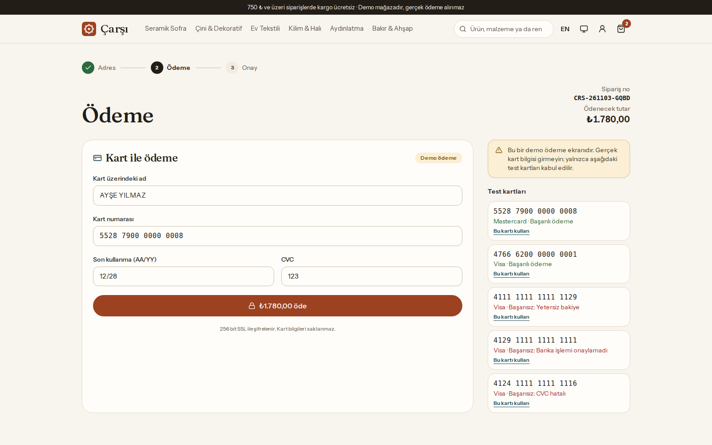 |

| Yönetim: genel bakış | Yönetim: siparişler |
|---|---|
| 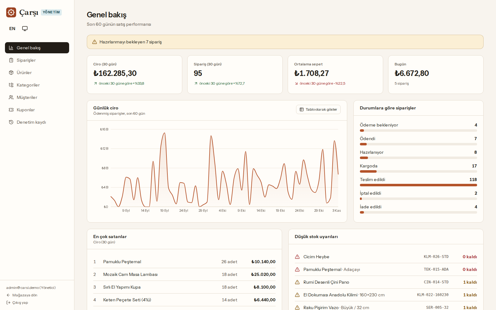 | 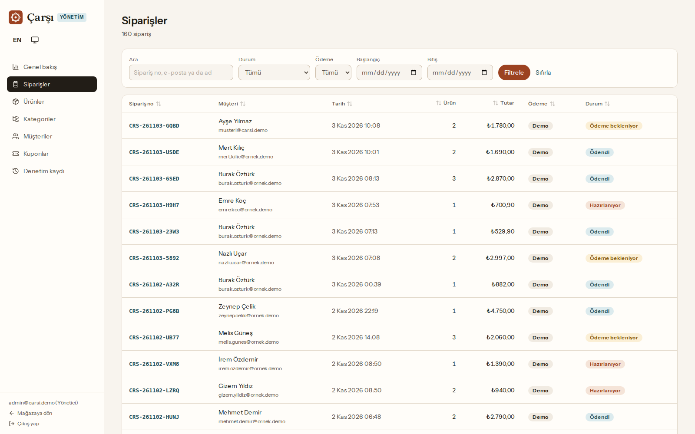 |

| Yönetim: sipariş detayı | Mobil | Mobil, koyu tema |
|---|---|---|
| 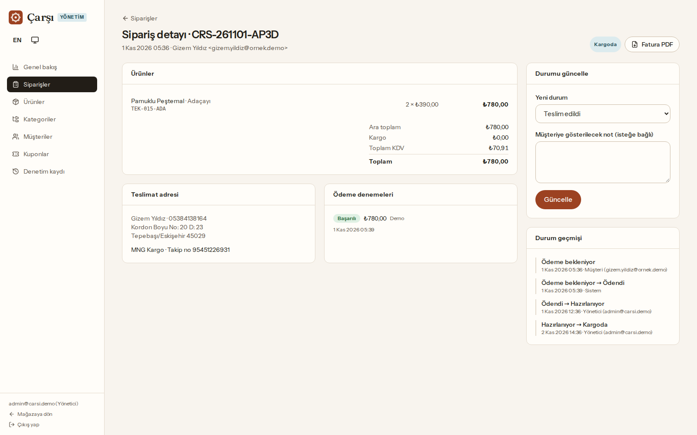 | 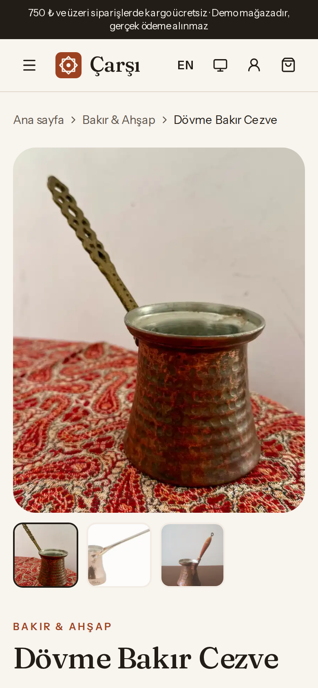 | 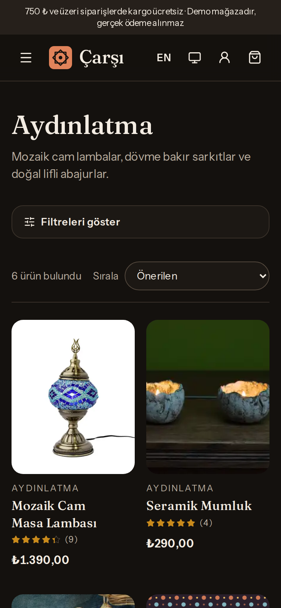 |

Görüntüler üretim derlemesinden Playwright ile alınır: `npm run build && npm run screenshots`.

## Mimari

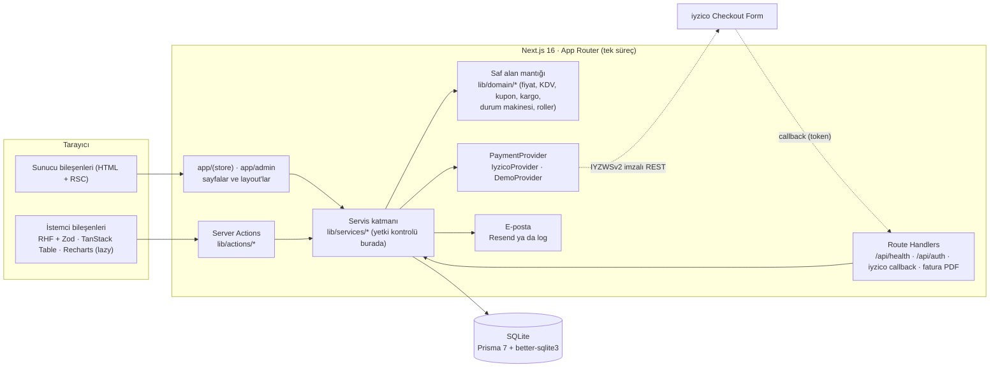

- `lib/domain` hiçbir şeye bağlı değildir (Prisma, Next, ağ yok) ve doğrudan birim testlerle doğrulanır.
- Yetki **servis katmanında** kontrol edilir (`assertCan(actor, "order:refund")`); sayfadaki yönlendirmeler yalnızca kullanıcı deneyimi içindir. Rol her istekte veritabanından yeniden okunur (JWT'deki rol bayatlamış olabilir).
- Formlar istemcide React Hook Form + Zod ile doğrulanır; sunucu aynı şemayla **ham** girdiyi yeniden doğrular (istemci dönüştürülmüş değeri değil ham değeri gönderir).

**Ödeme akışı**

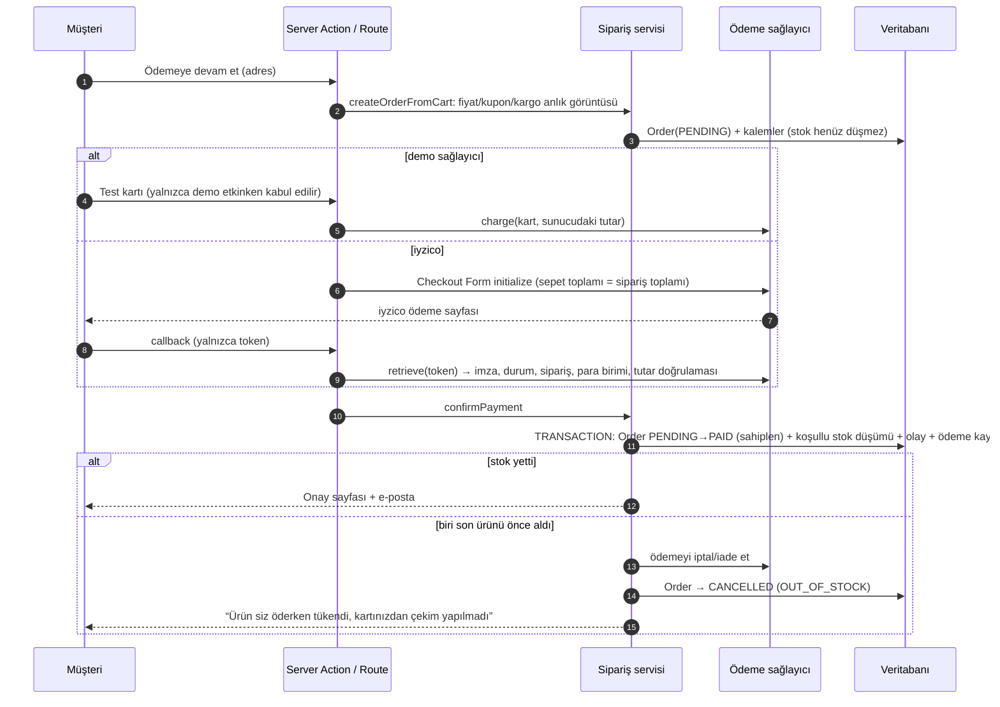

## Veri modeli

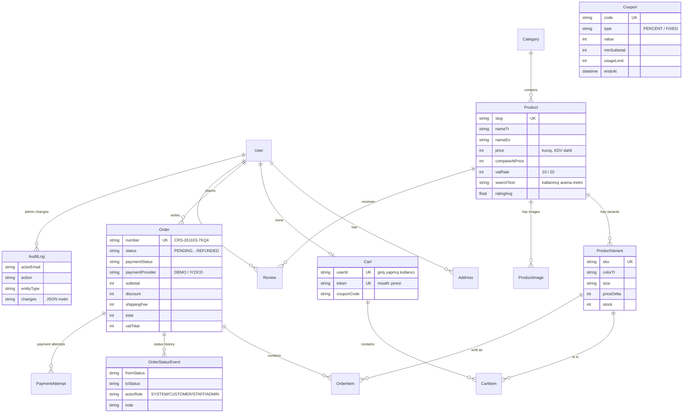

Tüm para tutarları **kuruş cinsinden tam sayıdır** (kayan nokta hatası yok). Sipariş kalemleri ürün adını, varyantı, birim fiyatı ve KDV oranını kopyalar; ürün sonradan değişse de sipariş ve fatura değişmez.

## Teknik kararlar

### Ödeme soyutlaması
`PaymentProvider` arayüzünün iki uygulaması vardır (`src/lib/payments`):
- **`IyzicoProvider`** — resmi SDK yerine doğrudan REST; istekler `IYZWSv2` (HMAC-SHA256: `randomKey + uriPath + body`) ile imzalanır. Akış: Checkout Form *initialize* → iyzico'nun barındırdığı ödeme sayfası → `callback`. Callback'te tarayıcının gönderdiği hiçbir şeye güvenilmez; yalnızca `token` alınır, sonuç iyzico'dan *retrieve* edilir ve sırayla doğrulanır: API durumu, **yanıt imzası** (`paymentStatus:paymentId:currency:basketId:conversationId:paidPrice:price:token` alanlarının HMAC-SHA256'sı, sabit zamanlı karşılaştırma), ödeme durumu, sahtekârlık durumu, sepet/konuşma kimliğinin bu siparişe ait olması, para birimi ve **tutar** (`price` sipariş toplamına eşit olmalı; `paidPrice` yalnızca taksit faizi kadar fazla olabilir). Sepet kalemleri indirim dağıtıldıktan sonra kuruşu kuruşuna sipariş toplamını verir.
- **`DemoProvider`** — anahtarlar yoksa kullanılır. Sitede gerçekçi bir kart formu (Luhn, son kullanma, CVC doğrulaması) ve test kartları; başarılı ve başarısız senaryolar seçilebilir. Siparişler “demo ödeme” olarak işaretlenir. Test kartı dışındaki numaralar reddedilir; iyzico etkinken demo ödeme eylemi kapalıdır.

Seçim `IYZICO_API_KEY` ve `IYZICO_SECRET_KEY` ikisi birden tanımlıysa iyzico, değilse demodur; anahtar yokken uygulama çökmez. iyzico tarafı ağ katmanı taklit edilerek birim testlerle doğrulanır (imza başlığı, imza doğrulama, tutar/sipariş uyuşmazlığı, sahte imza).

### Stok yarışı: son ürünü aynı anda iki kişi almaya çalışırsa
Stok sepete eklerken değil, **ödeme onaylanırken** ve tek bir transaction içinde düşer (`confirmPayment`, `src/lib/services/orders.ts`):
1. İlk ifade siparişi **sahiplenir**: `UPDATE Order SET status='PAID' … WHERE id=? AND status='PENDING'`. Aynı callback iki kez gelirse ikincisi 0 satır günceller (aynı ödeme referansıysa idempotent başarı döner).
2. Her kalem için **koşullu atomik güncelleme**: `UPDATE ProductVariant SET stock = stock - :adet WHERE id = :id AND stock >= :adet`. Etkilenen satır 0 ise `OutOfStockError` fırlatılır ve **tüm transaction geri alınır** (diğer kalemlerin düşümü dahil).
3. Kaybeden siparişin alınmış ödemesi sağlayıcıda iptal/iade edilir, sipariş `CANCELLED` olur ve müşteriye açıklanır.

Bu yaklaşım SQLite'ta ve PostgreSQL'de aynı şekilde doğrudur: SQLite yazarları sıraya koyar (ilk ifade bir yazma olduğu için kilit en baştan alınır; WAL modu + meşgul bekleme süresi), PostgreSQL'de ikinci `UPDATE` ilk transaction'ın commit'ini bekler ve `stock >= :adet` koşulunu yeni satır sürümüne göre yeniden değerlendirir. Doğrulama (entegrasyon testleri, gerçek migration'larla oluşturulan SQLite dosyası):
- Aynı süreçte eşzamanlı iki ödeme, stok 1 → tam olarak 1 başarılı, 1 `OUT_OF_STOCK`, stok 0.
- **Ayrı iki Node sürecinden** (iki sunucu örneği gibi, ayrı veritabanı bağlantıları) aynı anda başlayan ödemeler → yine 1 başarılı, 1 reddedilen.
- Dört süreç 3 adetlik stoktan 1–2'şer adet ister; 5 tur × 8 eşzamanlı alıcı: stok hiçbir zaman negatife düşmez ve `satılan + kalan = başlangıç`.

**SQLite bağlantı izolasyonu.** better-sqlite3 sürücü adaptörü süreç başına tek bağlantı kullanır ve yalnızca transaction'ları kendi arasında sıraya koyar; transaction dışı bir sorgu, başka bir isteğin açık transaction'ı sırasında aynı bağlantıda çalışıp onunla birlikte geri alınabilir. `src/lib/db.ts` adaptörü sarar: transaction dışı sorgular açık transaction bitene kadar bekler. Bu davranışın testi, sarmalayıcı kapatıldığında 3/3 çalıştırmada başarısız oluyor; sarmalayıcıyla geçiyor.

### Sipariş durum makinesi
`src/lib/domain/order-status.ts`: geçişler ve her geçişi yapabilecek roller tek bir tabloda.

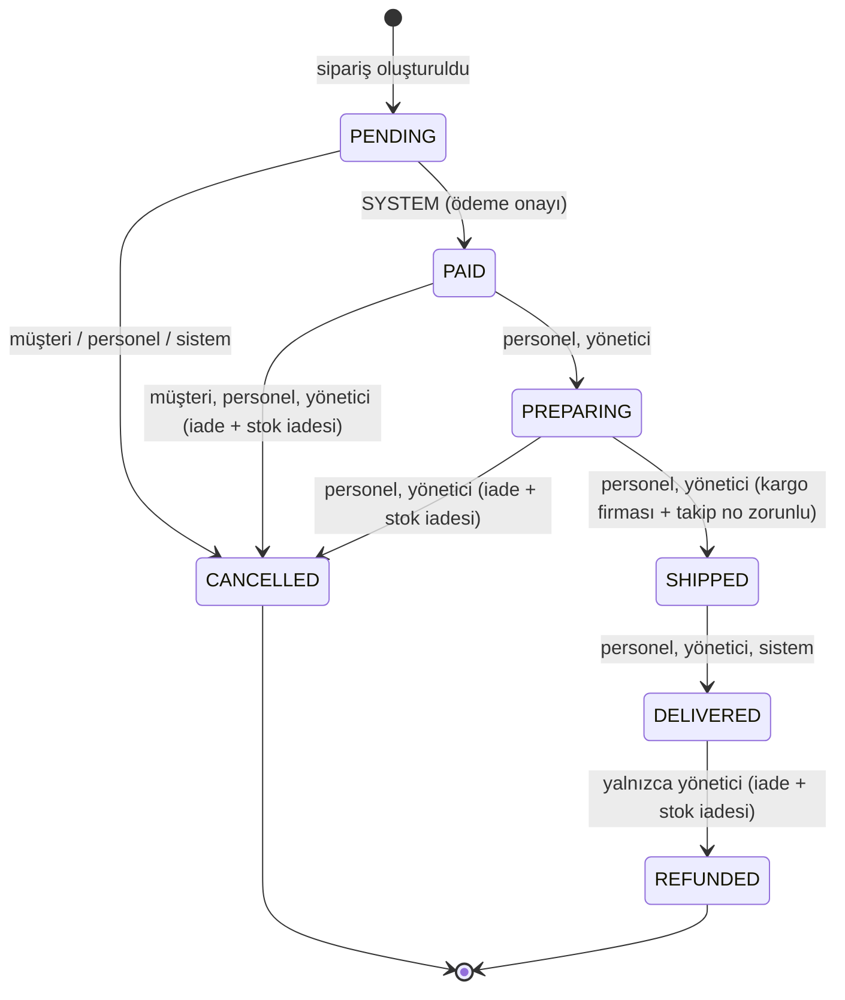

- “Ödendi” durumuna yalnızca ödeme doğrulaması (SYSTEM) geçirebilir; panelden elle “ödendi” yapılamaz.
- Geçişin yan etkileri tabloda tanımlıdır: stok alınmış bir siparişin iptali/iadesi ödemeyi sağlayıcıda iade eder ve stoğu geri ekler.
- Her geçiş `WHERE status = <eski durum>` ile yapılır (eşzamanlı iki personelden biri `CONFLICT` alır), `OrderStatusEvent` olarak loglanır (kim, hangi rol, not) ve personel/yönetici değişiklikleri ayrıca denetim kaydına yazılır. Müşteri başkasının siparişini denerse kayıt varlığı sızdırılmaz (404).

### Diğer
- **KDV:** fiyatlar KDV dahildir; KDV `brüt × oran / (100 + oran)` ile kalem bazında hesaplanır. Kupon indirimi kalemlere orantılı dağıtılır (kalan kuruşlar en büyük kalemlere), kargo ücretinin KDV'si (%20) ayrıca eklenir. Örnek veride tekstil ve kilim %10, diğerleri %20'dir (oranlar örnek amaçlıdır).
- **Arama:** SQLite'ın `LIKE`'ı Türkçe İ/ı'yı katlamadığı için ürünlerde katlanmış bir `searchText` sütunu tutulur; sorgu aynı şekilde katlanır (“İZNİK” = “iznik”). Kupon kodları da Türkçe harfler ASCII'ye çevrilerek büyük harfe dönüştürülür (`tr-TR` büyük harfi “i”yi “İ” yapar ve `HOSGELDIN10` ile eşleşmezdi; bu hata birim testte yakalandı).
- **Kimlik doğrulama:** Auth.js v5 (Credentials, JWT oturum), parolalar bcrypt ile; olmayan kullanıcıda da sahte karşılaştırma yapılarak süre farkı kapatılır. Giriş sonrası yönlendirme yalnızca site içi yollara izin verir.
- **Performans:** sayfalar sunucu bileşenleriyle render edilir; Recharts ve yorum formu (RHF + Zod) yalnızca gerektiğinde yüklenir; başlık fontu önceden yüklenmez (LCP görseliyle yarışmasın diye); LCP görselleri `priority` ve uygun `sizes` ile istenir; konteyner açılışında arka planda LCP görselleri önceden boyutlandırılır (`scripts/warm-cache.mjs`).
- **Görseller:** Wikimedia Commons'tan özgür lisanslı (CC0, PD, CC BY, CC BY-SA) fotoğraflar; `scripts/fetch-images.ts` manifestten indirir, lisansı denetler (NC/ND reddedilir), WebP'ye çevirir ve atıfları `src/data/image-credits.json`'a yazar. Atıflar `/gorsel-kaynaklari` sayfasında listelenir. Fotoğrafı olmayan ürünler için kategoriye özgü desenli kapaklar SVG olarak üretilir; yüklenemeyen bir görsel de kapağa düşer (kırık görsel yok). Admin'de girilen yerel görsel yolunun dosyası yoksa kayıt reddedilir.

## Çalıştırma

Gereksinimler: Node.js 22.12+ (başka bir şey gerekmez; veritabanı bir SQLite dosyasıdır).

```bash
npm ci                     # bağımlılıklar + prisma generate
cp .env.example .env       # isteğe bağlı; varsayılanlarla da çalışır
npx prisma migrate deploy  # data/carsi.db oluşturulur
npm run db:seed            # 40 ürün, 6 kategori, ~160 sipariş, yorumlar, kuponlar, demo hesaplar
npm run dev                # http://localhost:5309
```

Üretim derlemesi: `npm run build && npm start`. Seed deterministiktir (sabit tohumlu rastgelelik) ve tarihleri “bugün”e göre üretir; panel grafikleri her zaman son 60 günü gösterir.

## Testler ve kalite kapısı

| Komut | Kapsam |
|---|---|
| `npm run lint` | ESLint (Next core-web-vitals + TypeScript), `--max-warnings 0` |
| `npm run typecheck` | `tsc --noEmit`, `strict` + `noUncheckedIndexedAccess` |
| `npm test` | Vitest birim testleri: sepet ve kupon hesapları, kargo kuralı, durum makinesi ve roller, para/KDV, Zod şemaları, iyzico imza/callback doğrulaması (ağ taklidiyle), demo kartlar, arama, URL durumu, sözlük anahtar eşitliği |
| `npm run test:integration` | Gerçek migration'larla oluşturulan SQLite dosyasında: stok transaction'ı ve geri alma, aynı süreçte ve **ayrı süreçlerde** son ürün yarışı, idempotent ödeme onayı, rol bazlı yetki (müşteri hiçbir admin işlemi yapamaz; personel iade/kupon/denetim kaydı yapamaz), denetim kaydı, sepet birleştirme ve kupon |
| `npm run test:e2e` | Playwright, `next build` çıktısı + yeni seed edilmiş veritabanı + demo ödeme: misafir sepet → giriş → kupon → başarılı ödeme → sipariş görünür; reddedilen kart ve tekrar deneme; admin siparişi “kargoda” yapar → müşteride görünür; admin ürün ekler → mağazada ve denetim kaydında görünür; müşteri paneli açamaz; mobil menü/ürün/sepet (yatay kaydırma yok) ve dil değiştirme |
| `npm run lighthouse` | Çalışan sunucuya karşı Lighthouse (mobil): ana sayfa ve bir ürün sayfası |

Son yerel çalıştırma (bu depodaki kodla):

| Kontrol | Sonuç |
|---|---|
| Lint | 0 hata, 0 uyarı |
| Typecheck | temiz |
| Birim testleri | 6 dosya, **80/80** |
| Entegrasyon testleri | 3 dosya, **20/20** (3 ardışık çalıştırmada da) |
| E2E (Playwright) | **7/7** (5 masaüstü, 2 mobil) |
| Lighthouse mobil, ana sayfa | Performance **98**, Accessibility **100**, Best Practices **100**, SEO **100** |
| Lighthouse mobil, ürün sayfası | Performance **93–94**, Accessibility **100**, Best Practices **100**, SEO **100** |

Lighthouse notu: değerler üretim derlemesinde, görsel önbelleği ısındıktan sonra 3 ölçümün aralığıdır. Tamamen soğuk önbellekle (sunucunun görseli ilk kez boyutlandırdığı ilk ziyaret) ana sayfa 90 / ürün 88 ölçüldü; açılıştaki ısıtma betiği çalıştıktan sonraki ilk ölçüm 93 / 90'dır.

## Dağıtım: Render (Docker) + SQLite

Depoda bir `Dockerfile` ve örnek `render.yaml` (ücretsiz web servisi, `healthCheckPath: /api/health`) vardır. **Hiçbir gizli değer gerekmez.**

Konteyner açılışı (`docker/start.sh`):
1. `AUTH_SECRET` tanımlı değilse rastgele üretir ve uyarı loglar (Render'da `generateValue: true` ile üretilir).
2. `prisma migrate deploy` (SQLite dosyası: `/app/data/carsi.db`).
3. Veritabanı boşsa demo verisini seed eder (`scripts/bootstrap-db.ts`), doluysa atlar.
4. `next start` `$PORT` üzerinde (Render varsayılanı 10000) dinler; arka planda görsel önbelleğini ısıtır.

**Demo davranışı:** Render'ın ücretsiz planında disk geçicidir. Her yeniden başlatma ve dağıtımda veritabanı boş açılır ve demo temiz verilerle yeniden kurulur; ziyaretçilerin oluşturduğu siparişler ve hesaplar kalıcı değildir.

**Sunucu uyuyorsa:** Ücretsiz plan bir süre istek gelmezse uykuya geçer; ilk istek 30–60 saniye sürebilir (konteyner açılır, migration ve seed çalışır). Sonraki istekler normal hızdadır.

| Ortam değişkeni | Gerekli mi | Açıklama |
|---|---|---|
| `AUTH_SECRET` | Hayır | Auth.js anahtarı. Render'da `generateValue: true`. Yerelde/CI'da geliştirme değeri kullanılır; üretimde yoksa açılışta üretilir (oturumlar yeniden başlatmada düşer). |
| `DATABASE_URL` | Hayır | Varsayılan `file:/app/data/carsi.db` (konteyner), `file:./data/carsi.db` (yerel). |
| `SITE_URL` | Hayır | Sitemap, OpenGraph, e-posta bağlantıları ve iyzico callback adresi. Render'da yoksa `RENDER_EXTERNAL_URL` kullanılır. |
| `IYZICO_API_KEY`, `IYZICO_SECRET_KEY` | Hayır | İkisi birden tanımlıysa iyzico Checkout Form kullanılır; aksi halde demo ödeme. |
| `IYZICO_BASE_URL` | Hayır | Varsayılan sandbox: `https://sandbox-api.iyzipay.com`. |
| `RESEND_API_KEY`, `EMAIL_FROM` | Hayır | Tanımlıysa e-postalar Resend ile gönderilir; değilse yalnızca loglanır. |
| `DEMO_LOGIN_ENABLED` | Hayır | Giriş ekranındaki tek tıkla demo girişi (varsayılan `true`). |

**iyzico sandbox anahtarı (isteğe bağlı):** [sandbox-merchant.iyzipay.com](https://sandbox-merchant.iyzipay.com) adresinde ücretsiz bir sandbox üye işyeri hesabı açın; panelde gösterilen API anahtarını (API Key) ve güvenlik anahtarını (Secret Key) `IYZICO_API_KEY` / `IYZICO_SECRET_KEY` olarak tanımlayın (Render'da `sync: false` alanları). Sandbox'ta iyzico'nun kendi test kartları kullanılır. Callback adresi `SITE_URL` (ya da `RENDER_EXTERNAL_URL`) + `/api/payments/iyzico/callback` olur; tarayıcının erişebildiği herkese açık bir adres olmalıdır.

### Üretimde PostgreSQL'e geçiş
Şema bilinçli olarak taşınabilir tutuldu: enum yerine metin + Zod, `Json` yerine JSON metin, tutarlar tam sayı, büyük/küçük harf duyarsız arama için katlanmış sütun, tarih gruplama SQL yerine uygulamada.
1. `npm i @prisma/adapter-pg pg` ve `src/lib/db.ts`'de `PrismaBetterSqlite3` yerine `new PrismaPg({ connectionString: process.env.DATABASE_URL })` kullanın (SQLite'a özgü `PRAGMA` satırları ve bağlantı sarmalayıcısı kaldırılır; PostgreSQL bağlantı havuzu kullanır).
2. `prisma/schema.prisma`'da `provider = "postgresql"` yapın.
3. SQLite migration'larını silip PostgreSQL için yeniden üretin: `rm -rf prisma/migrations && DATABASE_URL=postgres://… npx prisma migrate dev --name init`.
4. `DATABASE_URL`'i PostgreSQL bağlantı adresine çevirin; Docker başlangıcındaki “boşsa seed et” adımını isterseniz kapatın (`scripts/bootstrap-db.ts`).
5. Stok düşümü kodu değişmez: koşullu `UPDATE … WHERE stock >= :adet` PostgreSQL'de satır kilidiyle aynı garantiyi verir. Entegrasyon testlerini bir PostgreSQL servis konteynerine karşı çalıştırmak için `vitest.integration.config.ts`'deki `DATABASE_URL`'i değiştirmek yeterlidir.

### CI
`.github/workflows/ci.yml`: lint, typecheck, birim ve entegrasyon testleri (SQLite, çoklu süreç yarışı dahil), üretim derlemesi, Playwright e2e; ayrı bir iş Docker imajını derleyip konteyneri başlatır ve `/api/health` yanıtını bekler.

## Proje yapısı

```
prisma/            şema, migration, seed ve katalog verisi (40 ürün, TR/EN)
src/app/(store)/   mağaza: ana sayfa, ürünler, ürün, sepet, ödeme, hesabım, giriş, görsel kaynakları
src/app/admin/     panel: genel bakış, siparişler, ürünler, kategoriler, müşteriler, kuponlar, denetim
src/app/api/       health, Auth.js, iyzico callback, fatura PDF
src/lib/domain/    saf iş kuralları (fiyat, KDV, kupon, kargo, durum makinesi, roller)
src/lib/services/  veritabanı ve yetki: sepet, sipariş, katalog, admin servisleri
src/lib/payments/  PaymentProvider, iyzico ve demo
src/lib/actions/   Server Actions (ince katman: doğrula → servis → revalidate)
src/lib/i18n/      TR/EN sözlükler
tests/             birim ve entegrasyon testleri; e2e/ Playwright
scripts/           görsel indirme, e2e sunucusu, Lighthouse, açılış seed'i, görsel önbelleği ısıtma
docker/start.sh    konteyner başlangıcı
```

## Bilinen sınırlamalar
- iyzico entegrasyonu gerçek sandbox anahtarlarıyla uçtan uca denenmedi; protokol (imzalı istekler, yanıt imzası, tutar doğrulaması) ağ taklidiyle test edildi. İade tam iptal (`/payment/cancel`) olarak uygulanmıştır; kısmi iade yoktur.
- Kupon kullanım sayısı ödeme onayında artırılır; kullanım limitinin son hakkı için eşzamanlı iki ödeme, limiti bir aşabilir.
- Dil tercihi çerezde tutulur (URL'de değil), bu yüzden İngilizce sayfalar ayrı URL olarak dizinlenmez.
- Ürün fotoğraflarının bir kısmı müze fotoğrafı ya da ürüne yakın (birebir aynı olmayan) Commons görselleridir; ayrıntılar `/gorsel-kaynaklari` sayfasındadır.

## Lisans
MIT — bkz. [LICENSE](LICENSE). Ürün fotoğrafları kendi lisanslarına tabidir (Görsel kaynakları sayfası); PDF faturadaki Noto Sans fontu SIL Open Font License 1.1 ile dağıtılır (`assets/fonts/OFL.txt`).

---

## English summary

**Çarşı** is a full-stack demo e-commerce store for handmade Anatolian goods (ceramics, tiles, kilims, textiles, copperware), built with Next.js 16 (App Router, Server Components, Server Actions), TypeScript (strict), Tailwind CSS v4, Prisma 7 on SQLite, Auth.js, Zod + React Hook Form, TanStack Table and Recharts.

- **Store:** URL-synced filtering/sorting/search/pagination, variant-aware product pages with verified-buyer reviews and JSON-LD, a guest cookie cart merged on sign-in, coupons (percent/fixed, validity, minimum, usage limit), a free-shipping threshold applied after discounts, VAT-inclusive TRY pricing, order timelines, PDF invoices, TR/EN UI and light/dark themes.
- **Payments:** a `PaymentProvider` abstraction with an iyzico Checkout Form implementation (IYZWSv2-signed REST, server-side callback verification of the response signature, order identity, currency and amount) and a demo test-card provider used by default when no keys are configured.
- **Correctness:** stock is taken in the payment-confirmation transaction using a claim-then-conditional-update pattern; integration tests prove that when two buyers race for the last unit — in one process or in two separate processes — exactly one wins and stock never goes negative. A small adapter wrapper isolates transactions on the single better-sqlite3 connection. Orders follow a role-aware state machine with logged history; admin changes are audited.
- **Admin:** dashboard (revenue chart, KPIs, best sellers, low stock), order management with status updates and refunds, product CRUD with variants and images, customers, coupons, categories and an audit log.
- **Quality gate (last local run):** lint 0/0, typecheck clean, 80 unit tests, 20 integration tests, 7 Playwright e2e tests; Lighthouse mobile 98/100/100/100 (home) and 93–94/100/100/100 (product page) with a warm image cache.
- **Deploy:** Docker on Render's free plan; the container migrates, seeds an empty database and starts on `$PORT`, so every restart brings back a clean demo. No secrets are required. See the Turkish sections above for environment variables and moving to PostgreSQL.

License: MIT.
